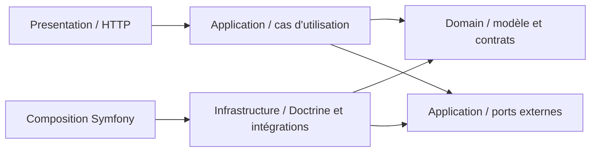

# Monolithe modulaire DentalSoftWeb

## Organisation

Le backend réside dans [api](../../api/). Il conserve Symfony 7.4, PHP 8.2, Doctrine et les migrations existantes. Le frontend cabinet et le portail patient consomment la même application HTTP. Les transports Messenger et Mercure appartiennent au monolithe ; aucun service distribué supplémentaire n'est introduit.

```text
api/
  config/                    Composition Symfony, mappings, routes, sécurité
  migrations/                Historique conservé + sessions renouvelables
  src/
    <Contexte>/
      Domain/                Entités, règles, enums, événements, ports de persistance
      Application/           Orchestration, services, DTO, ports externes, messages
      Infrastructure/        Doctrine, sécurité Symfony, intégrations, console
      Presentation/Api/      Adaptation HTTP
    SharedKernel/            Événements partagés, idempotence, erreurs HTTP
    System/                  Santé et diagnostics
  tests/
```



## Contextes et responsabilités

| Contexte | Responsabilité |
| --- | --- |
| Patient | Identité clinique, antécédents, allergies, portail et avis patients |
| ClinicalRecord | Fiches médicales, entretien, examens, bilans et documents |
| CareDelivery | Consultations, actes, prescriptions et clôture des soins |
| Scheduling | Rendez-vous, salles, réservations et congés |
| Billing | Devis, factures, règlements, assurances, lots et finances |
| Inventory | Consommables et mouvements de stock |
| IdentityAccess | Utilisateurs, rôles, appareils, sessions ; RH/paie historiques conservées |
| Communication | Notifications, SMS, boîte mail, temps réel et Web Push |
| Settings | Paramétrage du cabinet, mode local et maintenance |
| Reporting | Projections et rapports transversaux |
| Focus | Projections et publication du poste de réception |
| System | Santé et remontées d'erreurs client |
| SharedKernel | Primitives réellement partagées et adaptation technique commune |

La paie reste associée aux employés existants afin de préserver les transactions et les règles INPS. Un contexte Workforce autonome serait une évolution distincte du modèle métier, à réaliser avec ses propres contrats.

## Règles de dépendance

- Les contrôleurs adaptent le transport et appellent les services applicatifs. Les commandes console résident dans Infrastructure ; elles ne sont pas confondues avec les commandes de cas d'utilisation.
- Les implémentations de repositories résident dans `Infrastructure/Persistence/Doctrine`. Les ports publics sont dans `Domain/Repository`, liés par [repositories.yaml](../../api/config/repositories.yaml).
- Les nouveaux cas d'utilisation d'authentification dépendent des ports de repository, de signature et de contrôle d'appareil. Leur domaine ne dépend pas d'HTTP ni de Lexik. Le [tableau de bord Focus](06-focus-dashboard.md) utilise des ports dédiés pour ses projections, Reporting, le cache et l'horloge ; son service applicatif ne dépend plus d'une implémentation d'infrastructure.
- Les DTO sont rattachés à leur contexte : les DTO Focus et Billing ne sont plus des services auto-enregistrés.
- Les événements métier partagés résident dans SharedKernel. Un module ne doit pas importer un contrôleur d'un autre module.
- Les composants techniques Mercure, SMS, Web Push, sécurité et subscribers résident dans Infrastructure.

## Portée du DDD et couplages conservés

Il s'agit d'un DDD pragmatique, suivant le modèle observé dans Medinote : les attributs ORM sont conservés sur les entités et les associations Doctrine traversent encore les contextes. Les services historiques qui construisent des QueryBuilder ou utilisent directement EntityManager restent des exceptions identifiées ; leurs requêtes et transactions ne sont pas réécrites automatiquement. Les consommateurs compatibles sont injectés via des interfaces plutôt que les classes Doctrine. Les contrats de repository ne doivent pas devenir une API universelle de persistance.

La séparation des couches et les ports introduits ne signifient donc pas que toutes les frontières sont hermétiques. Pour renforcer progressivement ces frontières : extraire les requêtes restantes dans des projections/repositories, remplacer les associations traversantes par des identifiants et des contrats applicatifs, puis séparer les agrégats RH et financiers lorsque leurs invariants sont stabilisés. Ne pas modifier les invariants d'encaissement ou de paie dans une migration de namespaces.

## API et sécurité

Le [registre des routes](../../api/docs/route-migration.json) relie chaque route historique à sa route canonique. Les nouvelles URLs réutilisent les contrôleurs, leurs contrôles de rôles et leurs services ; il n'y a pas de redirection HTTP pour les mutations. La restriction patient et la modération des avis sont configurées explicitement pour les nouvelles URLs. Les erreurs non gérées des nouvelles routes suivent `application/problem+json`, sans exposer les exceptions internes ; les payloads métier historiques restent compatibles.

Les [sessions](04-authentification.md) reprennent le cycle JWT / refresh de Medinote avec rotation atomique, empreinte des credentials et liaison à l'appareil. Le modèle de déploiement reste une base par cabinet. Aucun `account_id` fictif ni rôle plateforme n'est ajouté.

## Déploiement et transition

1. Sauvegarder la base et les fichiers persistants selon les procédures existantes.
2. Déployer depuis le contexte `api/` ; les chemins Compose, scripts et documents actifs sont mis à jour. Le nom du service Docker et les volumes existants sont conservés.
3. Installer les dépendances avec `composer install`, puis exécuter `php bin/console doctrine:migrations:migrate --no-interaction`. La seule nouvelle table est `auth_refresh_token` ; les tables métier ne sont pas renommées.
4. Vider/réchauffer le cache Symfony et redémarrer les workers. Les métadonnées et proxies utilisent les nouveaux namespaces.
   Un pont d'autoload conserve la lecture des anciens messages Messenger pendant la transition ; les empreintes de receipts d'idempotence conservent aussi leur espace utilisateur historique.
5. Les JWT antérieurs sans `realm` et version de credentials imposent une reconnexion. Les clients actuels peuvent toujours lire `token` et utiliser leurs URLs historiques.
6. Migrer ensuite les services frontend vers les nouvelles routes et le renouvellement. La durée JWT reste d'une heure pour préserver les clients qui ne renouvellent pas encore.

Un retour à la version précédente peut laisser la nouvelle table inutilisée ; ne pas la supprimer tant que des sessions nouvelles doivent être conservées. Ne jamais rejouer des fixtures ou recréer la base sur un cabinet existant.

## Vérification

Depuis `api/` : `composer validate --no-check-publish`, `php bin/console lint:container`, `php bin/console lint:yaml config`, `php bin/console doctrine:schema:validate --skip-sync`, `php vendor/phpunit/phpunit/phpunit`.

Les tests existants de facturation, paie, permissions et confidentialité sont conservés. Les nouveaux tests vérifient la rotation et son rollback, les tokens expirés/révoqués, les espaces et appareils étrangers, les collisions d'emails et le routage réel. Les tests MySQL existants nécessitent leur variable d'activation et une base de test ; leur omission ne constitue pas une validation de production.
