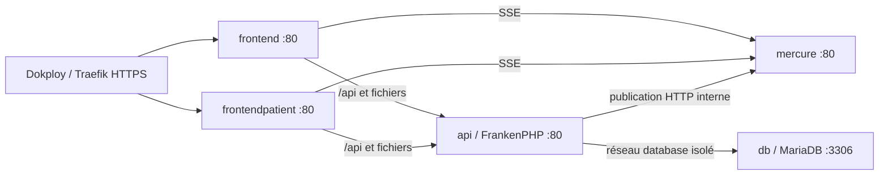

# Déployer DentalSoft avec Dokploy

Une application **Docker Compose** et une stack par cabinet, construite depuis la
racine avec [docker-compose.dokploy.yml](../docker-compose.dokploy.yml).

## Installation

1. Créer un service **Docker Compose** Dokploy relié au dépôt, contexte `.` et
   chemin du Compose `docker-compose.dokploy.yml` (pas le mode Swarm Stack).
2. Copier [le modèle complet](../.env.dokploy.example) dans **Environment**.
   Choisir un `INSTANCE_ID` unique et stable, `CABINET`, les deux URLs HTTPS sans slash final, et remplacer les cinq
   secrets. Générer chaque secret séparément avec `openssl rand -hex 32`.
3. Dans **Domains**, créer ces deux entrées, HTTPS / Let's Encrypt, chemin `/`,
   sans « Strip Path » :

   | Domaine | Service | Port |
   |---|---|---|
   | Hôte de `ADMIN_URL` | `frontend` | `80` |
   | Hôte de `PATIENT_URL` | `frontendpatient` | `80` |

4. Faire pointer le DNS vers le serveur Dokploy puis **Deploy**.

Le réseau externe `dokploy-network` est fourni par Dokploy. Conserver les réseaux
déclarés, sans activer une option qui les remplace. Aucun domaine ni port hôte
n'est nécessaire pour l'API, la base ou Mercure.

Cabinets communs aux deux applications : `default`, `cdos`, `mondentiste`,
`orodent`, `massaman`. Pour un autre cabinet, ajouter sa configuration et ses
assets aux deux applications. Le branding/PWA reste sélectionné au build ;
changer `CABINET` nécessite un rebuild. Le développement local reste disponible.

## Routage



Chaque navigateur appelle `/api` sur son propre domaine. Les frontends relaient
`/api`, `/uploads`, `/upload_files`, `/assurances` et `/health` sans modifier le
chemin. Ils conservent les headers d'authentification et les informations HTTPS.
La limite d'upload est de 256 Mio, cohérente avec PHP (50 Mio par fichier).
La résolution DNS est renouvelée après remplacement d'un conteneur interne.
Ces routes sont exclues du fallback SPA et du fallback de navigation PWA.

L'API publie vers `http://mercure/.well-known/mercure`. Elle communique aux clients
une URL canonique `${ADMIN_URL}/.well-known/mercure`, identique pour les topics
et les droits JWT. Les deux origines sont autorisées côté hub. Les deux frontends
relaient `/.well-known/mercure` avec buffering, cache, compression et logs d'URL
désactivés, et autorisent les connexions longues. Ne pas ajouter de middleware
Traefik de buffering ou compression sur cet endpoint.

Seuls les frontends rejoignent `dokploy-network`. MariaDB rejoint uniquement le
réseau `database` marqué `internal`. L'API rejoint aussi le réseau privé normal
pour conserver l'accès Internet des fournisseurs SMS et Web Push.

## Variables Dokploy

Toutes les variables déployables figurent dans [le modèle](../.env.dokploy.example).
Les secrets `.env` locaux ne sont pas copiés dans les images. Les connexions
internes, le mode production et les chemins JWT sont raccordés par le Compose.

| Variables | Utilisation |
|---|---|
| `INSTANCE_ID` | Identité unique et stable des réseaux, volumes et alias internes |
| `CABINET` | Branding partagé des deux builds |
| `ADMIN_URL`, `PATIENT_URL` | Origines HTTPS, sans slash final |
| `APP_SECRET` | Secret stable, notamment pour chiffrer les accès fournisseurs SMS |
| `DB_PASSWORD`, `DB_ROOT_PASSWORD` | Accès MariaDB distincts |
| `JWT_PASSPHRASE` | Protection des clés RSA persistantes ; stable |
| `MERCURE_JWT_SECRET` | Secret commun API/hub, 32 octets minimum |
| `DB_NAME`, `DB_USER`, `DB_SERVER_VERSION` | Base et version Doctrine, MariaDB 11.4 par défaut |
| `DB_BUFFER_POOL_SIZE`, `DB_MAX_CONNECTIONS` | Cache InnoDB (128 Mio) et connexions (50) |
| `*_MEMORY_LIMIT` | Plafonds Docker par service, sans réservation de RAM |
| `FRANKENPHP_IMAGE` | Image versionnée, surcharge possible par digest |
| `TRUSTED_PROXIES` | `REMOTE_ADDR` : proxy direct interne, API sans accès public |
| `CORS_ALLOW_ORIGIN` | `a^` (aucune origine externe), car l'API est appelée à même origine |
| `APP_INTERNET_FEATURES_ENABLED` | Fonctionnalités Internet |
| `RUN_MIGRATIONS` | `1` : migrations au démarrage ; `0` pour gestion manuelle |
| `ENABLE_EMBEDDED_WORKER` | `1` : workers SMS/Messenger embarqués |
| `MESSENGER_*`, `SMS_*` | Transport, durée, mémoire et fréquence des workers |
| `MERCURE_TOPIC_NAMESPACE` | Namespace des notifications du cabinet |
| `MERCURE_PUBLISH_*`, `MERCURE_CIRCUIT_COOLDOWN_SECONDS` | Timeouts et circuit breaker |
| `MERCURE_HISTORY_SIZE` | Nombre d'événements visé pour la rétention Bolt |
| `VAPID_*` | Web Push facultatif ; vide pour le désactiver |

Le DSN MariaDB est construit au démarrage avec encodage automatique des accès.
Dans Environment, protéger les valeurs contenant `$` par des quotes simples selon
la syntaxe dotenv/Compose ; les secrets hexadécimaux évitent cette difficulté.
Modifier les mots de passe dans Environment ne modifie pas les comptes d'une base
déjà initialisée : effectuer la rotation SQL avant de redéployer.

## Démarrage et persistance

La base et le transport Mercure doivent être sains avant le démarrage de l'API.
L'API génère les clés JWT absentes dans le volume, exécute les migrations, crée
les transports Messenger, puis prépare le cache et les proxies Doctrine. Les
frontends attendent la santé de l'API. Un échec de migration bloque la mise en service.

Les workers existants restent dans l'API pour conserver cinq services : traitement
périodique SMS et consommation `async` avec relance du consumer. Conserver **un
réplica API** avec cette configuration (migrations et poll SMS concurrents sinon).
Pour augmenter la charge, séparer ultérieurement les workers.

Les volumes conservent MariaDB, les clés JWT, les trois dossiers de fichiers publics,
les fichiers privés, les sauvegardes et l'historique Mercure. Le cache Symfony reste
propre au conteneur. Logs sur stderr/stdout, rotation Docker : 3 fichiers de 10 Mio.
Les réseaux privés, alias et volumes sont nommés avec `INSTANCE_ID` pour isoler
plusieurs cabinets, même si Dokploy impose son propre nom de projet Compose.
Garder cet identifiant stable. Sauvegarder la base, les volumes fichiers/JWT
et les secrets Environment. Ne pas supprimer les volumes lors d'un redéploiement.
Les fichiers publics gardent le modèle d'accès actuel ; les volumes privés ne sont
pas routés. L'exécution de PHP dans les dossiers de fichiers publics est bloquée.

Une base vide reçoit le schéma, pas les données métier ni un administrateur par
défaut. Importer les données du cabinet ou utiliser le processus existant de
création de compte. Pour reprendre une production, copier aussi les uploads et
les clés JWT, conserver `APP_SECRET` et la passphrase. Les scripts
[d'import](../backend-reform/scripts/db-import-data.sh) et
[d'export](../backend-reform/scripts/db-export-data-only.sh) retrouvent leur
utilitaire de préparation dans le même dossier.

## Versions

- FrankenPHP **1.13.4**, PHP **8.2** pour préserver le runtime existant. Le build
  refuse PHP antérieur à **8.2.35** ou aux correctifs correspondants des branches
  8.3/8.4/8.5. Il contrôle aussi les prérequis Composer. Aucun secret au build.
- Mercure **1.1.5**, avec `protocol_version_compatibility 8` : le composant Symfony
  verrouillé et les clients utilisent les claims `mercure` et `topic=` du protocole
  0.x. Le mode moderne exige une migration coordonnée des JWT et abonnements ; le
  désactiver casserait les notifications. Aucun accès anonyme activé ; les anciens
  JWT conservent les règles de validation 0.x.
- MariaDB **11.4**, branche LTS ; Node **22** pour construire les applications.

Références : [FrankenPHP 1.13.4](https://github.com/php/frankenphp/releases/tag/v1.13.4),
[correctifs PHP](https://github.com/php/frankenphp/releases/tag/v1.13.2),
[migration Mercure](https://mercure.rocks/docs/UPGRADE),
[domaines Compose Dokploy](https://docs.dokploy.com/docs/core/docker-compose/domains).

## Vérification

Avec Docker installé, copier le modèle vers `.env.dokploy`, remplacer ses valeurs,
puis depuis la racine :

```sh
docker compose --env-file .env.dokploy -f docker-compose.dokploy.yml config --quiet
docker compose --env-file .env.dokploy -f docker-compose.dokploy.yml build --pull
```

Dokploy injecte lui-même l'environnement sur le serveur. Ne jamais publier la
sortie complète de `config`, qui contient les secrets.

Après déploiement :

1. Vérifier les cinq services, `/api/health` sur chacun des deux domaines et le
   rechargement direct des routes SPA.
2. Vérifier `/api/health/mercure` : ce diagnostic valide la joignabilité, pas les JWT.
3. Se connecter, envoyer une notification et vérifier le flux SSE HTTP 200 et la
   réception côté destinataire. Tester SMS et Web Push si configurés.
4. Vérifier un upload, son téléchargement et sa persistance après redéploiement.
   Contrôler `php -v` dans le conteneur `api`.

Les anciens déploiements, dumps et notes sont regroupés sous
[archive](../archive/README.md), hors des contextes de build.

## Maintenir les déploiements individuels

Les [instructions de déploiement individuel](deploiement-individuel.md) et le
dossier [Mercure autonome](../mercure-prod/) restent disponibles. Les lanceurs
manuels `deploy.ps1` et `deploy.bat` restent à la racine, avec leur fonctionnement
précédent. Vérifier leurs cibles serveur avant chaque exécution.

| Mode | Point d'entrée |
|---|---|
| API Docker individuelle | `backend-reform/Dockerfile`, contexte `backend-reform` |
| Frontend admin individuel | `frontend/Dockerfile`, contexte racine |
| Portail patient manuel | `npm run build:cabinet -- --cabinet=...`, dans `patient-frontend` |
| Mercure individuel | `mercure-prod/Dockerfile`, contexte `mercure-prod` |
| Stack complète | `docker-compose.dokploy.yml` |

Le Dockerfile, l'entrypoint, le Caddyfile, les règles d'exclusion et la configuration
Symfony de l'API individuelle sont conservés. La stack utilise
`backend-reform/Dockerfile.dokploy` et ses fichiers spécifiques. Les nouveaux YAML
de configuration sont copiés dans `config/packages` uniquement lors de ce build.
Le contexte frontend Dokploy est filtré par `docker/frontend/Dockerfile.dockerignore` ;
aucun filtre racine ne modifie les builds individuels.

Le routage navigateur à même origine est activé exclusivement par
`VITE_DOKPLOY=true`, défini dans le nouveau Dockerfile frontend. Laisser cette
variable absente des builds individuels : ils gardent les URLs et la priorité de
configuration précédentes, ainsi que les commandes existantes.

## Plusieurs cabinets sur le même serveur

Utiliser un service Compose Dokploy par instance et des IDs tels que `cdos-prod`,
`orodent-prod`, `cdos-test`. `CABINET=cdos` peut être partagé entre prod et test,
mais jamais `INSTANCE_ID`. Utiliser des domaines et des secrets distincts.

Les volumes et réseaux privés portent explicitement cet ID. Les frontends
résolvent des alias tels que `dentalsoft-cdos-prod-api`, jamais un simple `api`
potentiellement présent dans un déploiement individuel sur `dokploy-network`.
La base et Mercure restent hors du réseau partagé, sans ports hôte ni noms de
conteneur imposés. Les plafonds mémoire réduisent le risque qu'un cabinet sature
la RAM ; ils ne réservent pas de mémoire et n'isolent pas les I/O disque ou le CPU.

Si la première version de ce Compose a déjà été déployée, les nouveaux noms de
volumes ne reprennent pas automatiquement ses données. Avant migration, sauvegarder
et recopier les volumes existants vers les nouveaux, ou conserver leurs noms dans
le Compose. Ne jamais redéployer sur une base vide en supposant une reprise automatique.

## Budget RAM

Estimations de dimensionnement, **pas des mesures du projet**, pour un petit
cabinet et une charge légère à modérée, hors construction des images :

| Service actif | RAM estimée | Plafond Docker initial |
|---|---:|---:|
| Frontend cabinet Nginx (2 workers) | 15–50 Mio | 128 Mio |
| Frontend patient Nginx (2 workers) | 15–50 Mio | 128 Mio |
| API FrankenPHP seule (2 threads) | 200–450 Mio | 1024 Mio |
| Surcoût SMS + Messenger embarqués | +100–250 Mio | inclus dans l'API |
| MariaDB (InnoDB 128 Mio, 50 connexions max.) | 200–450 Mio | 768 Mio |
| Mercure (petit nombre de connexions SSE) | 30–120 Mio | 256 Mio |

La stack complète représente environ **560–1370 Mio**, soit prévoir **1,5–2 Gio
par cabinet en exploitation** avec marge. Sans workers, environ 460–1120 Mio.
Arrêter le portail patient seul économise peu (15–50 Mio). Une API + les deux
frontends avec DB et Mercure externes représente environ 330–800 Mio avec workers ;
il faut compter séparément la mémoire des services externes.

La somme des plafonds par défaut est **2304 Mio (2,25 Gio)**, pas une consommation
permanente. Un dépassement peut provoquer un arrêt OOM du conteneur : ajuster
les plafonds après mesure. Le `memory_limit` de PHP et le seuil Messenger ne sont
pas une limite globale de tous les processus du conteneur.

Pour le serveur, ajouter une enveloppe initiale de **1–2 Gio** pour Linux,
Docker, Dokploy et Traefik, à vérifier sur l'installation réelle. Prévoir **2–4 Gio
supplémentaires pendant un build**, particulièrement celui de l'interface admin ;
les limites runtime ci-dessus ne limitent pas BuildKit. Construire les images
successivement ou hors du serveur de production si la RAM est serrée. Une machine
de 4 Gio convient à un petit cabinet si les builds sont déportés ; pour plusieurs
cabinets, calculer la somme avec marge et mesurer avant d'en ajouter.

Depuis le serveur, après une période représentative d'utilisation :

```sh
docker compose --env-file .env.dokploy -f docker-compose.dokploy.yml stats --no-stream
```

Observer également les pics, les redémarrages/OOM et la mémoire disponible sur
l'hôte. Les uploads, exports, imports, requêtes concurrentes et abonnements SSE
peuvent dépasser ces fourchettes. Les caches de fichiers et métriques Docker ne
correspondent pas exactement à la seule mémoire PHP.

Les paramètres influents sont documentés par
[FrankenPHP](https://frankenphp.dev/docs/performance/) et
[MariaDB](https://mariadb.com/docs/server/ha-and-performance/mariadb-memory-allocation).
